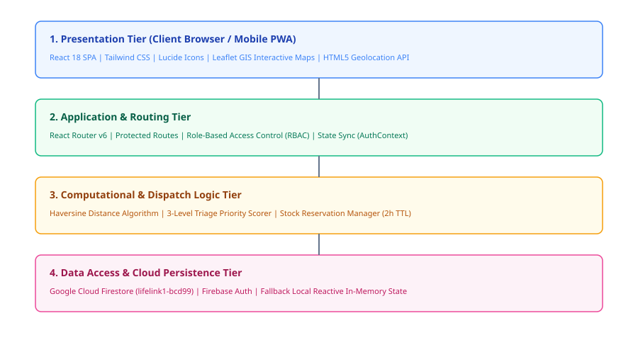
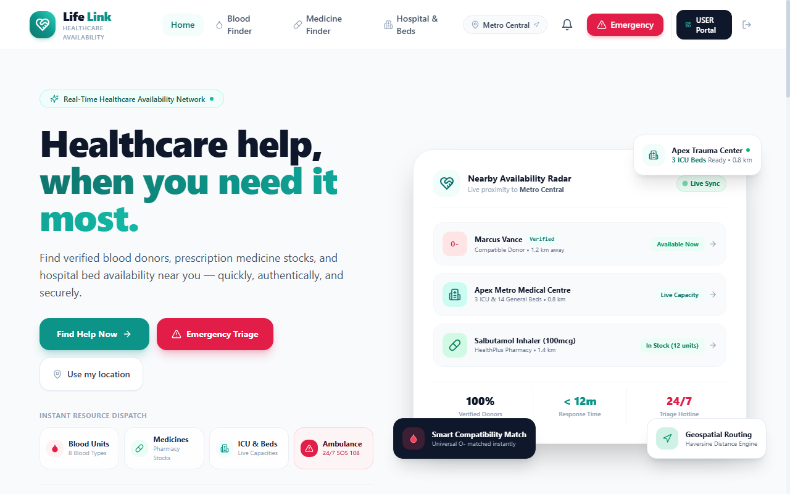
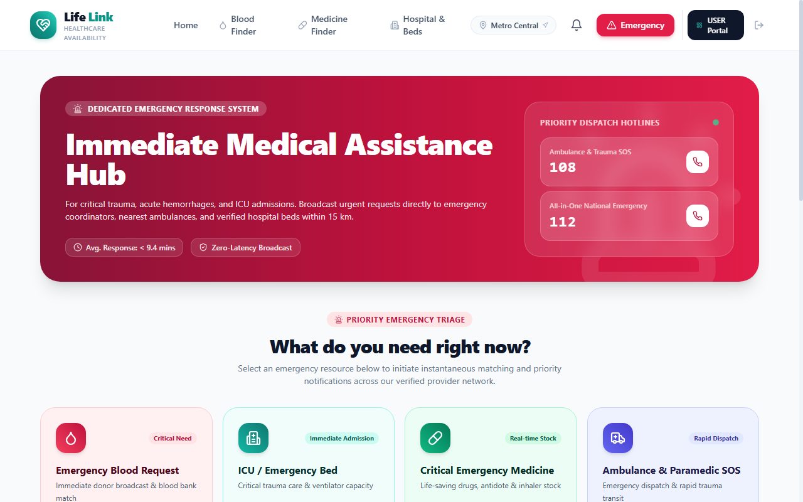
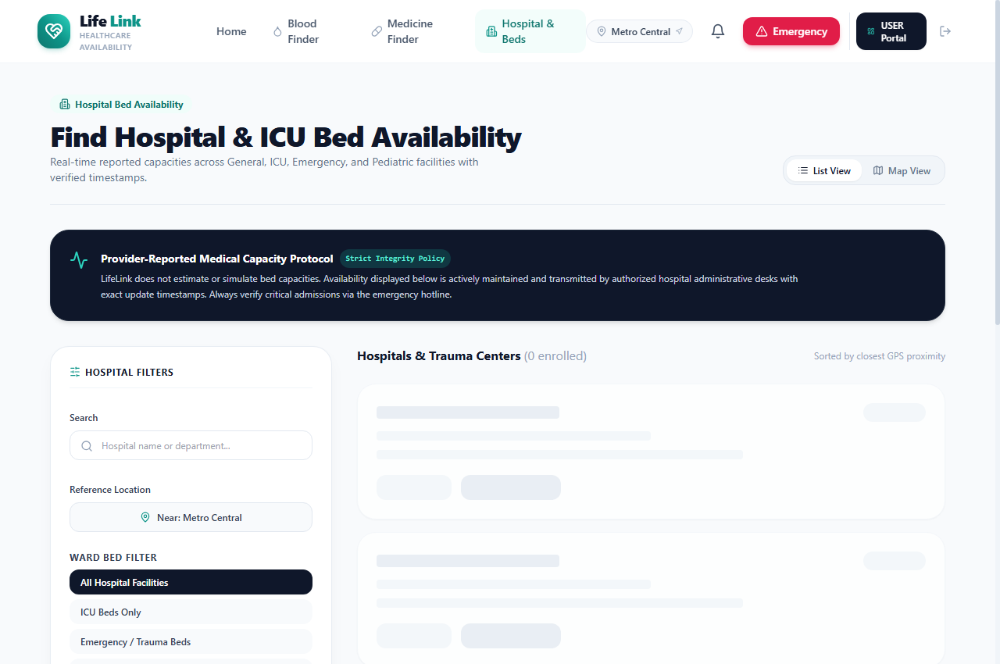
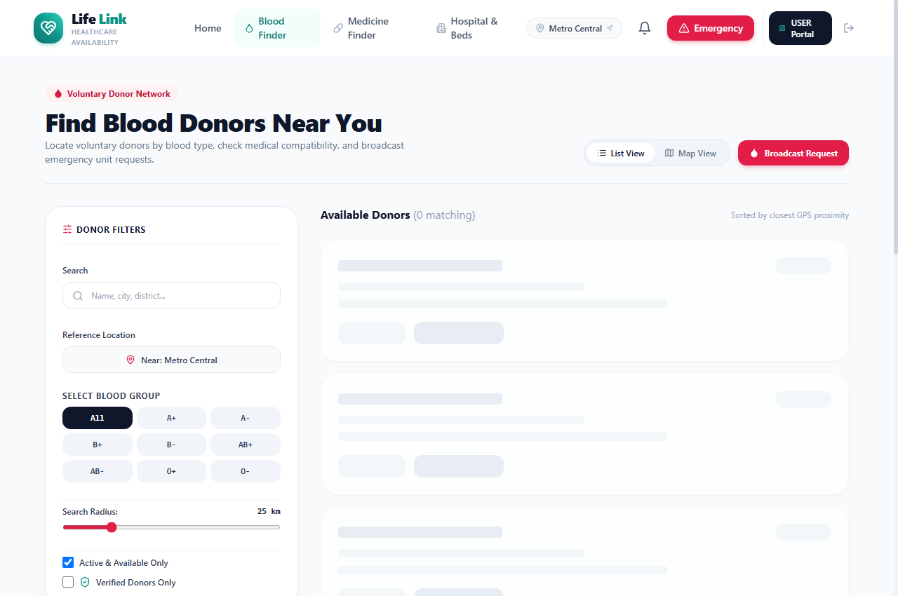
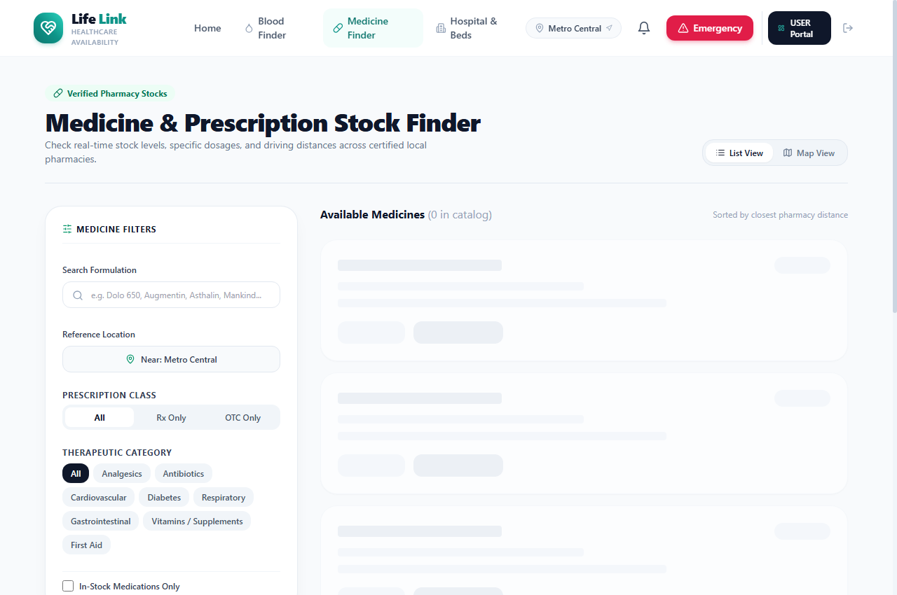
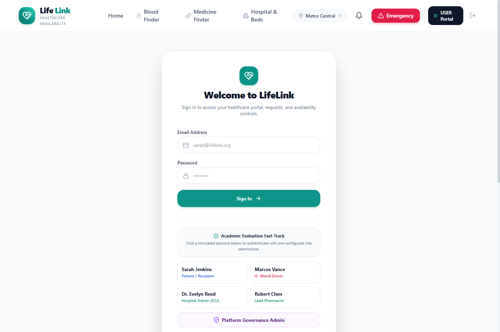
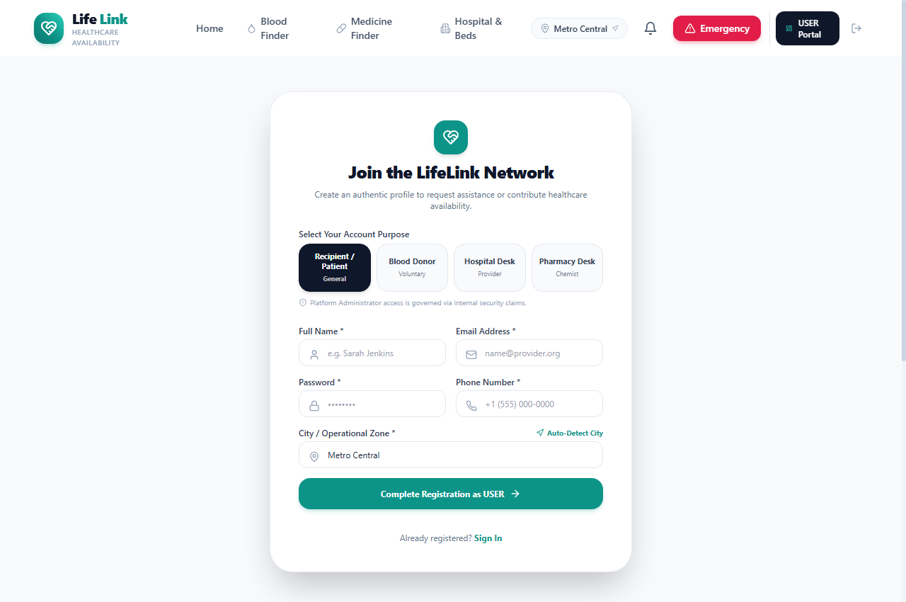
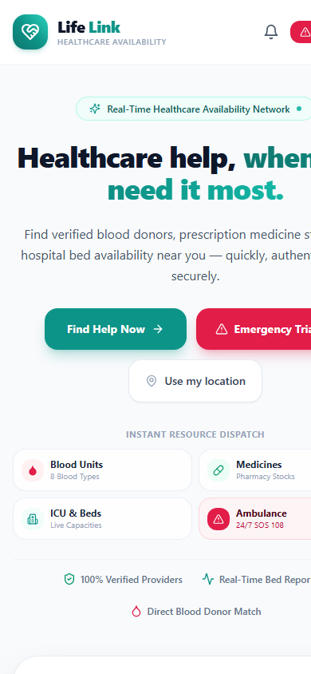

# LifeLink — Healthcare Availability & Emergency Assistance Platform

[](https://mu.ac.in/)
[](https://vivacollege.org/)
[](https://react.dev/)
[](https://tailwindcss.com/)
[](https://leafletjs.com/)
[](https://firebase.google.com/)
[](https://lifelinkviva.netlify.app/)
[](LICENSE)

> **A real-time, decentralized healthcare availability discovery and emergency triage assistance network designed to eliminate information asymmetry during the "Golden Hour" of critical medical distress.**

---

## 📌 Academic Information

| Field | Academic Details |
| :--- | :--- |
| **Project Title** | LifeLink — Healthcare Availability & Emergency Assistance Platform |
| **Course & Class** | Bachelor of Science in Computer Science (B.Sc. CS — TYCS Semester VI) |
| **University** | **University of Mumbai** |
| **Institution** | **VIVA College of Arts, Commerce & Science**, Virar (West), Maharashtra - 401303 |
| **Department** | Department of Computer Science |
| **Student Candidate** | **SINGH ANURAG SAROJ** |
| **Roll Number** | **102** |
| **Project Guide** | **Mrs. Jyoti Jadhav** (*Assistant Professor, Dept. of Computer Science*) |
| **Head of Department** | **Mrs. Priyanka Brid** (*Head, Dept. of Computer Science*) |
| **Academic Year** | 2026 – 2027 |
| **Live Web App** | [https://lifelinkviva.netlify.app/](https://lifelinkviva.netlify.app/) |
| **Project Black Book** | [docs/LifeLink_TYCS_Black_Book_Singh_Anurag_Saroj.pdf](docs/LifeLink_TYCS_Black_Book_Singh_Anurag_Saroj.pdf) |

---

## 🚨 Problem Statement & Motivation

During acute trauma, cardiac arrest, obstetric complications, or sudden vehicular accidents, the survival rate drops precipitously with every 15-minute delay in intensive clinical admission (the **"Golden Hour"**). In metropolitan and municipal regions such as Mumbai and Vasai-Virar, patients and attendants routinely lose 45–90 minutes calling hospitals sequentially to verify vacant ICU beds, broadcasting uncoordinated WhatsApp messages for rare blood donors, or navigating to closed pharmacies late at night.

**LifeLink** resolves this systemic information blindness through a lightweight, zero-install, single-page application (SPA) providing sub-second discovery of verified emergency resources within a unified operational radar.

---

## ✨ Core System Modules

| Module | Core Functionality & Technical Highlights |
| :--- | :--- |
| **🩸 Blood Donor Matching** | Geolocation-aware indexing across all 8 ABO/Rh blood groups (`A+`, `A-`, `B+`, `B-`, `AB+`, `AB-`, `O+`, `O-`). Includes verified donor trust badges, proximity calculation via the Haversine formula, direct click-to-call links, and 1-click emergency blood broadcast alerts. |
| **🏥 ICU & Bed Telemetry** | Real-time tracking of Intensive Care Unit (ICU), Emergency Trauma, General Inpatient, and Pediatric beds across regional medical facilities, augmented by continuous Oxygen Support and Mechanical Ventilator readiness indicators. |
| **💊 24/7 Pharmacy Stock** | Real-time pharmaceutical inventory locator for urgent prescription and OTC therapeutics (e.g. Dolo 650, Augmentin 625 Duo, Asthalin Inhalers, Lantus Insulin) with transparent Indian Rupee (₹) pricing, 24-hour store filters, and a 2-hour reservation hold mechanism. |
| **🚨 1-Tap Emergency SOS** | Rapid emergency triage dispatch capturing device GPS coordinates and reverse-geocoding to street-level landmarks via OpenStreetMap Nominatim. Provides instant one-touch dialers for national helplines (**108 Ambulance, 102 Maternal, 1075 Health Helpline, 112 Unified Emergency**). |
| **🛡️ Role-Based Portals (RBAC)**| Distinct administrative dashboards for Patients, Voluntary Donors, Hospital Bed Managers, Pharmacists, and Platform Governance Admins with real-time operational controls. |

---

## 🏛️ System Architecture

LifeLink utilizes a modular **4-Tier Layered Architecture** ensuring complete separation of presentation, routing, computational logic, and asynchronous cloud persistence:



```
┌────────────────────────────────────────────────────────────────────────┐
│                   1. Presentation Tier (Client SPA)                   │
│   React 18.3 | Vite 5.2 | Tailwind CSS 3 | Lucide React | Leaflet GIS  │
└───────────────────────────────────┬────────────────────────────────────┘
                                    │
┌───────────────────────────────────▼────────────────────────────────────┐
│                  2. Routing & State Management Tier                    │
│   React Router DOM v6 | AuthContext | LocationContext | DataContext   │
└───────────────────────────────────┬────────────────────────────────────┘
                                    │
┌───────────────────────────────────▼────────────────────────────────────┐
│               3. Domain Logic & Spatial Computing Tier                 │
│  Haversine Distance Engine | 3-Tier Emergency Triage | 2h Stock Hold  │
└───────────────────────────────────┬────────────────────────────────────┘
                                    │
┌───────────────────────────────────▼────────────────────────────────────┐
│                4. Persistence & Cloud BaaS Service Tier                │
│    Google Cloud Firestore (lifelink1-bcd99) + Client Reactive Engine   │
└────────────────────────────────────────────────────────────────────────┘
```

---

## 📸 Application Interface Gallery

| Landing Page & Real-Time Radar | Priority Emergency SOS Triage |
| :---: | :---: |
|  |  |
| **Hospital Bed & ICU Tracker** | **Blood Donor Search & Matching** |
|  |  |
| **24/7 Pharmacy Medicine Locator** | **Role-Based Authentication** |
|  |  |
| **Stakeholder Registration** | **Responsive Mobile Viewport (390px)** |
|  |  |

---

## 🔑 Fast-Track Examiner & Demo Evaluation Logins

To enable seamless academic evaluation, LifeLink provides **1-Click Instant Demo Access** directly on the Login screen, as well as the following pre-configured credentials:

| Role | Demo Email | Password | Access Scope & Dedicated Actions |
| :--- | :--- | :--- | :--- |
| **Patient / Recipient** | `user@lifelink.org` | `demo123` | Broadcast blood requests, reserve critical medicines, dispatch emergency SOS alerts. |
| **Voluntary Donor** | `donor@lifelink.org` | `demo123` | Toggle availability status (`AVAILABLE` ↔ `RECENTLY_DONATED`), view incoming blood requests. |
| **Hospital Bed Manager** | `hospital@lifelink.org` | `demo123` | Real-time increment/decrement of available ICU, Trauma, and General beds. |
| **Pharmacy Chemist** | `pharmacy@lifelink.org` | `demo123` | Update emergency drug quantities, adjust pricing, manage active stock. |
| **Governance Admin** | `admin@lifelink.org` | `demo123` | Verify donor badges, review emergency dispatch telemetry, sync Firestore database. |

---

## 🛠️ Technology Stack

* **Frontend Framework:** [React 18.3](https://react.dev/) with [Vite 5.2](https://vitejs.dev/)
* **CSS & Utility Styling:** [Tailwind CSS 3.4](https://tailwindcss.com/) with PostCSS & Autoprefixer
* **Geospatial & Mapping:** [Leaflet 1.9](https://leafletjs.com/) with OpenStreetMap & Nominatim Reverse Geocoding
* **Iconography:** [Lucide React](https://lucide.dev/)
* **Cloud Database & Auth:** [Google Cloud Firestore](https://firebase.google.com/) (Project: `lifelink1-bcd99`)
* **Local Fallback Engine:** Client-Side Reactive Storage (`storage.js`) with custom window event dispatching
* **Hosting & CI/CD:** [Netlify Global Edge CDN](https://www.netlify.com/) continuously synced with GitHub

---

## 🚀 Local Installation & Execution

### Prerequisites
* [Node.js](https://nodejs.org/) (Version 18.0 or higher)
* [Git](https://git-scm.com/)

### Step-by-Step Setup
```bash
# 1. Clone the repository
git clone https://github.com/kaju2818/lifeLink.git

# 2. Navigate to the project directory
cd lifeLink

# 3. Install required dependencies
npm install

# 4. Start local development server
npm run dev
```

The application will be accessible at: **`http://localhost:5173/`**

### Production Build
```bash
# Compile and optimize production bundle
npm run build

# Preview production build locally
npm run preview
```

---

## 📂 Repository Directory Structure

```
lifeLink/
│
├── docs/                                 # Academic Documentation & Assets
│   ├── LifeLink_TYCS_Black_Book_Singh_Anurag_Saroj.pdf  # 64-Page Official Black Book Report
│   ├── LifeLink_TYCS_Black_Book_Singh_Anurag_Saroj.md   # Complete Markdown Source
│   └── images/                           # High-Resolution UML Diagrams & UI Screenshots
│       ├── fig01_wbs.svg                 # Work Breakdown Structure
│       ├── fig02_gantt.svg               # 15-Week Project Gantt Schedule
│       ├── fig03_usecase.svg             # UML Use Case Diagram
│       ├── fig04_class.svg               # UML Class Diagram
│       ├── fig09_er.svg                  # Entity-Relationship (ER) Diagram
│       ├── fig10_deployment.svg          # Cloud Deployment Architecture
│       ├── fig11_dfd0.svg                # Data Flow Diagram (Level 0 Context)
│       ├── fig14_architecture.svg        # 4-Tier Layered Architecture
│       └── fig15_home.png ...            # High-Resolution UI Screenshots
│
├── public/                               # Public Static Web Assets
│   └── favicon.svg                       # LifeLink Healthcare Icon
│
├── src/                                  # React 18 Application Source Code
│   ├── components/                       # Shared UI Components (Navbar, Footer, Map, Drawers)
│   ├── context/                          # Global React State (Auth, Geolocation, Data)
│   ├── data/                             # Realistic Clinical Mock Datasets (mockData.js)
│   ├── pages/                            # Public Views (Home, BloodFinder, HospitalFinder, SOS)
│   │   └── dashboards/                   # Role-Protected Stakeholder Dashboards
│   ├── services/                         # Firebase Firestore SDK & Reactive Storage Engine
│   ├── App.jsx                           # Route Declarations & RBAC Security Guards
│   ├── index.css                         # Tailwind CSS Directives & Custom Animations
│   └── main.jsx                          # Application Bootstrap Entry
│
├── index.html                            # HTML5 Shell
├── package.json                          # Dependencies & NPM Scripts
├── vite.config.js                        # Vite Build Bundler Configuration
├── tailwind.config.js                    # Custom Design Tokens & Brand Colors
└── README.md                             # Repository Documentation
```

---

## 📜 University Submission & Certification

This mini-project report and software codebase have been developed in partial fulfillment of the requirements for the award of the Degree of **Bachelor of Science in Computer Science (B.Sc. CS — TYCS Semester VI)**, affiliated to the **University of Mumbai**.

* **Student Candidate:** **Singh Anurag Saroj** (Roll No: **102**)
* **Department:** Department of Computer Science
* **College:** VIVA College of Arts, Commerce & Science, Virar (West)
* **Supervisor / Guide:** Mrs. Jyoti Jadhav
* **Head of Department:** Mrs. Priyanka Brid

---

## ⚖️ License

This project is licensed under the **MIT License** — see the [LICENSE](LICENSE) file for full details.
