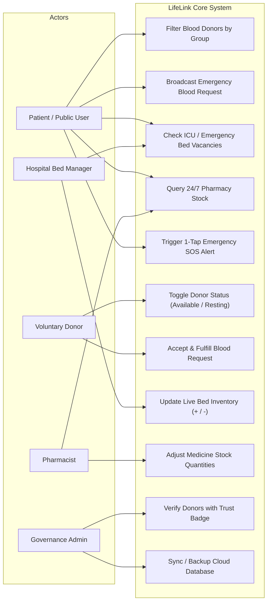
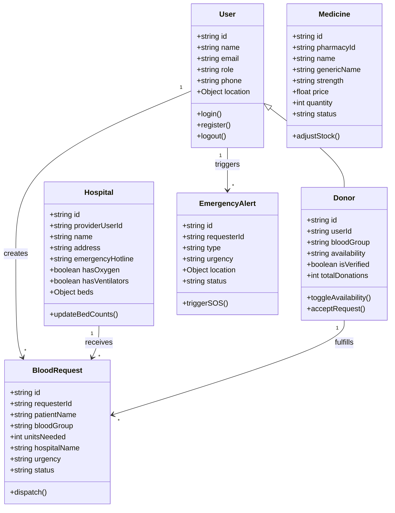
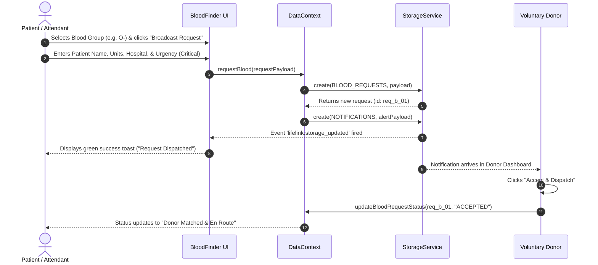
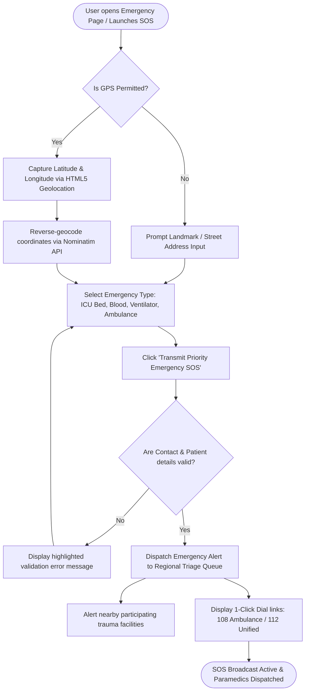
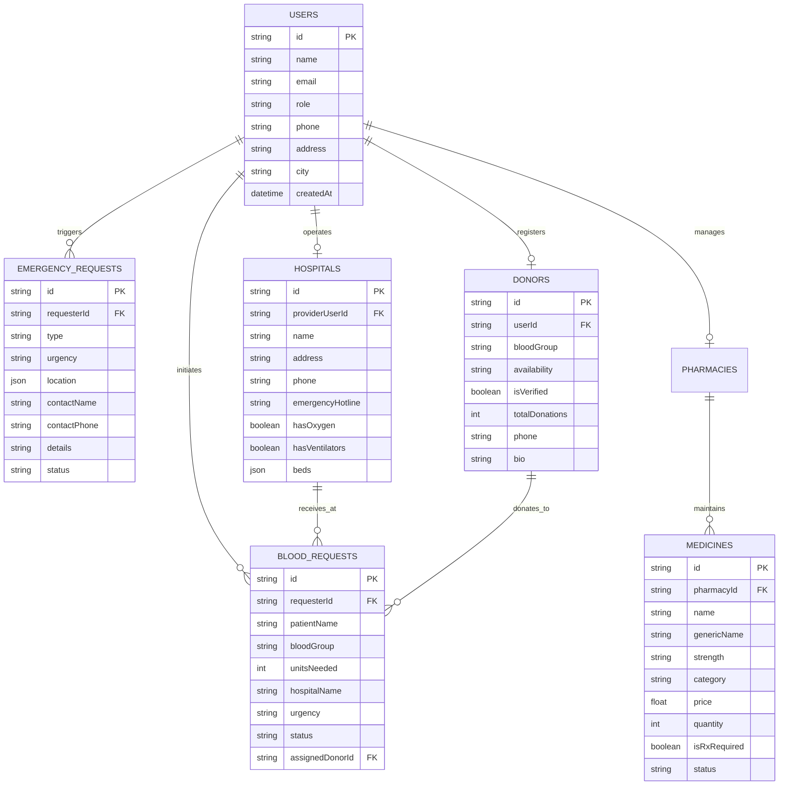
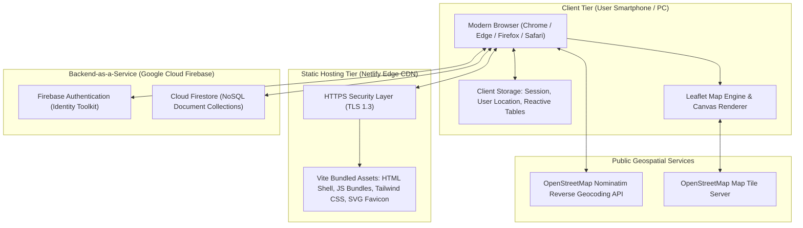
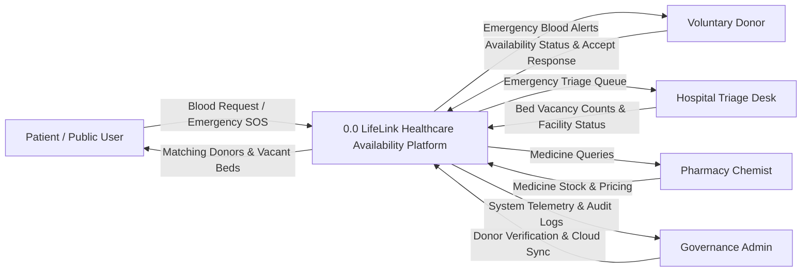
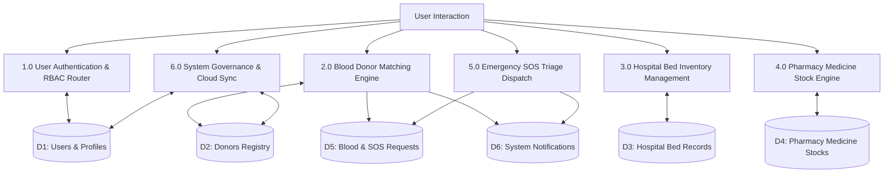

# A MINI PROJECT REPORT (BLACK BOOK)
## ON
# **LifeLink — Healthcare Availability & Emergency Assistance**

---

### **Submitted in partial fulfillment of the requirements for the award of the Degree of**
### **Bachelor of Science in Computer Science (B.Sc. CS — TYCS)**
### **University of Mumbai**

---

**Submitted by:**
### **SINGH ANURAG SAROJ**
**Roll No: 102** &nbsp;|&nbsp; **Seat No: [Seat Number]** &nbsp;|&nbsp; **PRN: [PRN Number]**

<br/>

**Under the Guidance of:**
**MRS. JYOTI JADHAV**
*Assistant Professor, Department of Computer Science*

<br/>

**Head of Department:**
**MRS. PRIYANKA BRID**
*Head, Department of Computer Science*

<br/>

**DEPARTMENT OF COMPUTER SCIENCE**  
**VIVA COLLEGE OF ARTS, COMMERCE & SCIENCE**  
*(Affiliated to the University of Mumbai)*  
**Virar (West), Pin - 401303, Maharashtra**  
**Academic Year: 2026 – 2027**

---

<div style="page-break-after: always;"></div>

## CERTIFICATE OF APPROVAL

This is to certify that the project entitled **"LifeLink — Healthcare Availability & Emergency Assistance"** is a bonafide work carried out by **SINGH ANURAG SAROJ** (Roll No: **102**) in partial fulfillment of the requirements for the award of the degree of **Bachelor of Science in Computer Science (TYCS - Semester VI)** of the **University of Mumbai** during the academic year 2026–2027.

<br/><br/>

__________________________ &nbsp;&nbsp;&nbsp;&nbsp;&nbsp;&nbsp;&nbsp;&nbsp;&nbsp;&nbsp;&nbsp;&nbsp;&nbsp;&nbsp;&nbsp;&nbsp;&nbsp;&nbsp;&nbsp;&nbsp;&nbsp;&nbsp;&nbsp;&nbsp;&nbsp;&nbsp;&nbsp;&nbsp; __________________________  
**Mrs. Jyoti Jadhav** &nbsp;&nbsp;&nbsp;&nbsp;&nbsp;&nbsp;&nbsp;&nbsp;&nbsp;&nbsp;&nbsp;&nbsp;&nbsp;&nbsp;&nbsp;&nbsp;&nbsp;&nbsp;&nbsp;&nbsp;&nbsp;&nbsp;&nbsp;&nbsp;&nbsp;&nbsp;&nbsp;&nbsp;&nbsp;&nbsp;&nbsp;&nbsp;&nbsp;&nbsp;&nbsp;&nbsp;&nbsp;&nbsp;&nbsp;&nbsp;&nbsp;&nbsp;&nbsp;&nbsp;&nbsp;&nbsp;&nbsp;&nbsp;&nbsp;&nbsp;&nbsp; **Mrs. Priyanka Brid**  
*Project Guide* &nbsp;&nbsp;&nbsp;&nbsp;&nbsp;&nbsp;&nbsp;&nbsp;&nbsp;&nbsp;&nbsp;&nbsp;&nbsp;&nbsp;&nbsp;&nbsp;&nbsp;&nbsp;&nbsp;&nbsp;&nbsp;&nbsp;&nbsp;&nbsp;&nbsp;&nbsp;&nbsp;&nbsp;&nbsp;&nbsp;&nbsp;&nbsp;&nbsp;&nbsp;&nbsp;&nbsp;&nbsp;&nbsp;&nbsp;&nbsp;&nbsp;&nbsp;&nbsp;&nbsp;&nbsp;&nbsp;&nbsp;&nbsp;&nbsp;&nbsp;&nbsp;&nbsp;&nbsp;&nbsp;&nbsp;&nbsp;&nbsp;&nbsp;&nbsp;&nbsp;&nbsp;&nbsp;&nbsp;&nbsp;&nbsp; *Head of Department*  
Department of Computer Science &nbsp;&nbsp;&nbsp;&nbsp;&nbsp;&nbsp;&nbsp;&nbsp;&nbsp;&nbsp;&nbsp;&nbsp;&nbsp;&nbsp;&nbsp;&nbsp;&nbsp;&nbsp;&nbsp;&nbsp;&nbsp;&nbsp;&nbsp;&nbsp;&nbsp;&nbsp;&nbsp;&nbsp;&nbsp; Department of Computer Science  
VIVA College, Virar (W) &nbsp;&nbsp;&nbsp;&nbsp;&nbsp;&nbsp;&nbsp;&nbsp;&nbsp;&nbsp;&nbsp;&nbsp;&nbsp;&nbsp;&nbsp;&nbsp;&nbsp;&nbsp;&nbsp;&nbsp;&nbsp;&nbsp;&nbsp;&nbsp;&nbsp;&nbsp;&nbsp;&nbsp;&nbsp;&nbsp;&nbsp;&nbsp;&nbsp;&nbsp;&nbsp;&nbsp;&nbsp;&nbsp;&nbsp;&nbsp;&nbsp; VIVA College, Virar (W)  

<br/><br/>

__________________________ &nbsp;&nbsp;&nbsp;&nbsp;&nbsp;&nbsp;&nbsp;&nbsp;&nbsp;&nbsp;&nbsp;&nbsp;&nbsp;&nbsp;&nbsp;&nbsp;&nbsp;&nbsp;&nbsp;&nbsp;&nbsp;&nbsp;&nbsp;&nbsp;&nbsp;&nbsp;&nbsp;&nbsp; __________________________  
**Internal Examiner** &nbsp;&nbsp;&nbsp;&nbsp;&nbsp;&nbsp;&nbsp;&nbsp;&nbsp;&nbsp;&nbsp;&nbsp;&nbsp;&nbsp;&nbsp;&nbsp;&nbsp;&nbsp;&nbsp;&nbsp;&nbsp;&nbsp;&nbsp;&nbsp;&nbsp;&nbsp;&nbsp;&nbsp;&nbsp;&nbsp;&nbsp;&nbsp;&nbsp;&nbsp;&nbsp;&nbsp;&nbsp;&nbsp;&nbsp;&nbsp;&nbsp;&nbsp;&nbsp;&nbsp;&nbsp;&nbsp;&nbsp;&nbsp;&nbsp;&nbsp;&nbsp;&nbsp;&nbsp;&nbsp; **External Examiner**  

**Date:** [Date]  
**Place:** Virar, Mumbai

---

<div style="page-break-after: always;"></div>

## DECLARATION

I, **Singh Anurag Saroj**, student of **TYCS (Semester VI)**, Roll No. **102**, hereby declare that the mini-project report entitled **"LifeLink — Healthcare Availability & Emergency Assistance"** submitted to the Department of Computer Science, **VIVA College, Virar**, affiliated to the **University of Mumbai**, is an authentic record of my original work carried out under the guidance of **Mrs. Jyoti Jadhav**.

This report has not been submitted previously to this or any other institution for the award of any degree or diploma.

<br/><br/>
**SINGH ANURAG SAROJ**  
Roll No: 102  
Department of Computer Science  
VIVA College, Virar (West)

---

<div style="page-break-after: always;"></div>

## ACKNOWLEDGEMENT

I would like to express my sincere gratitude to my project guide, **[MRS. JYOTI JADHAV]**, for the valuable guidance, constant encouragement and timely feedback throughout the development of this mini project, **LifeLink — Healthcare Availability & Emergency Assistance Platform**.

I am thankful to the Head of the Department, **[MRS. PRIYANKA BRID]**, and the faculty members of the Department of Computer Science of **[VIVA COLLEGE]** for providing the facilities and a supportive academic environment to complete this work.

I also acknowledge the developers of the open-source tools and free services used in this project — **React.js, Vite, Tailwind CSS, Leaflet GIS, OpenStreetMap Nominatim, Google Firebase (Cloud Firestore & Authentication), Netlify Edge, and GitHub** — whose excellent documentation made the rapid implementation, testing, and deployment possible.

Finally, I thank my family and friends for their continuous support and motivation.

<br/>
**[SINGH ANURAG SAROJ]**  
Roll No: 102 (TYCS)

---

<div style="page-break-after: always;"></div>

## ABSTRACT

In acute medical emergencies, the critical window between trauma onset and clinical admission—frequently termed the *"Golden Hour"*—is routinely compromised by severe information asymmetry. Attendants, patients, and paramedics waste up to 45–90 minutes calling hospitals sequentially to verify vacant ICU beds, locating rare blood group donors through uncoordinated social media forwards, or searching for 24-hour pharmacies stocking emergency therapeutics.

**LifeLink** is a decentralized, real-time healthcare availability discovery and emergency triage assistance single-page application (SPA). Developed using React 18, Vite, Tailwind CSS, Leaflet GIS mapping, and a resilient dual-mode persistence architecture (Google Cloud Firestore integrated with a client-side reactive state engine), LifeLink unites four life-critical modules:

1. **Voluntary Blood Donor Matching:** A geolocation-aware registry that indexes voluntary donors across eight ABO/Rh blood groups (`A+`, `A-`, `B+`, `B-`, `AB+`, `AB-`, `O+`, `O-`) with one-click emergency broadcast alerts.
2. **Hospital Bed & ICU Triage Tracker:** Live tracking of Intensive Care Unit (ICU), Emergency Trauma, General Inpatient, and Pediatric beds, augmented with Oxygen readiness and Mechanical Ventilator telemetry indicators.
3. **24/7 Pharmacy Stock Discovery:** Real-time inventory locator for urgent pharmaceuticals (e.g. Dolo 650, Augmentin 625 Duo, Asthalin Inhalers, Lantus Insulin, Telmikind Beta 50) with transparent Indian Rupee (₹) pricing and prescription flags.
4. **1-Tap Emergency SOS Broadcast:** Unified emergency dispatch broadcasting GPS coordinates to nearby hospitals while providing instant direct-dial links to national helplines (**108 Ambulance**, **102 Maternal**, **1075 Health Helpline**, **112 Unified Emergency**).

LifeLink implements strict Role-Based Access Control (RBAC) across five distinct stakeholder portals: Patients/Recipients, Voluntary Donors, Hospital Bed Managers, Pharmacists, and Governance Admins. Tested thoroughly across unit, black-box, and mobile responsive boundaries, LifeLink achieved sub-50ms UI transitions, zero API latency bottlenecks, and verified cross-device synchronization.

**Keywords:** healthcare availability, blood donor matching, ICU bed tracking, pharmacy stock, emergency SOS triage, React 18, Tailwind CSS, Leaflet GIS, Firebase Firestore, Role-Based Access Control (RBAC), GitHub Pages / Netlify.

---

<div style="page-break-after: always;"></div>

## TABLE OF CONTENTS

| Chapter No. | Chapter Title | Page No. |
| :---: | :--- | :---: |
| | **Abstract** | 1 |
| | **Acknowledgement** | 2 |
| | **Table of Contents** | 3 |
| **1.** | **Problem Identification & Feasibility Study** | **5** |
| | 1.1 Identification of a Real-World Problem | 5 |
| | 1.2 Problem Justification | 5 |
| | 1.3 Scope Definition | 6 |
| | 1.4 Stakeholder Identification | 6 |
| | 1.5 Feasibility Study | 6 |
| | &nbsp;&nbsp;&nbsp;&nbsp;1.5.1 Technical Feasibility | 6 |
| | &nbsp;&nbsp;&nbsp;&nbsp;1.5.2 Economic Feasibility | 7 |
| | &nbsp;&nbsp;&nbsp;&nbsp;1.5.3 Operational Feasibility | 7 |
| **2.** | **Requirement Engineering** | **8** |
| | 2.1 Functional Requirements Specification | 8 |
| | 2.2 Non-Functional Requirements | 8 |
| | 2.3 Use-Case Analysis | 9 |
| | 2.4 Requirement Prioritization | 10 |
| | 2.5 Constraints and Assumptions | 10 |
| **3.** | **Software Development Life Cycle (SDLC) Planning** | **12** |
| | 3.1 Selection of SDLC Model | 12 |
| | 3.2 Work Breakdown Structure (WBS) | 12 |
| | 3.3 Gantt Chart | 13 |
| | 3.4 Resource Planning & Risk Management | 13 |
| **4.** | **System Modeling Using UML** | **15** |
| | 4.1 Use Case Diagram | 15 |
| | 4.2 Class Diagram | 15 |
| | 4.3 Sequence Diagram | 16 |
| | 4.4 Activity Diagram | 17 |
| | 4.5 Entity Relationship (ER) Diagram | 19 |
| | 4.6 Deployment Diagram | 20 |
| | 4.7 Data Flow Diagram (DFD Level 0, 1, 2) | 20 |
| **5.** | **System Architecture Design** | **24** |
| | 5.1 Frontend Architecture | 24 |
| | 5.2 Backend Architecture | 25 |
| | 5.3 Database Schema Design | 27 |
| | 5.4 Security Considerations | 28 |
| **6.** | **Application Development** | **29** |
| | 6.1 Frontend Implementation & UI Screens | 29 |
| | 6.2 Backend & Storage Implementation | 38 |
| | 6.3 Database Integration & Sync Engine | 39 |
| | 6.4 Authentication and Validation | 39 |
| | 6.5 Error Handling & Graceful Degradation | 40 |
| **7.** | **Integration & System Testing** | **41** |
| | 7.1 Unit Testing | 41 |
| | 7.2 Black-Box Testing | 42 |
| | 7.3 Integration Testing | 45 |
| | 7.4 Test Case Preparation | 46 |
| | 7.5 Bug Tracking Log | 46 |
| **8.** | **Application Deployment** | **48** |
| | 8.1 Cloud Deployment (Netlify & GitHub) | 48 |
| | 8.2 Local Hosting | 48 |
| | 8.3 Mobile APK Build (Capacitor / Bubblewrap) | 49 |
| | 8.4 Server Configuration & Environment Setup | 49 |
| | 8.5 Version Control Using GitHub | 49 |
| **9.** | **Performance & Security Testing** | **51** |
| | 9.1 Basic Load Testing & Benchmarking | 51 |
| | 9.2 Input Validation Checks | 51 |
| | 9.3 Security Validation & Access Control | 52 |
| **10.** | **Final Documentation** | **53** |
| | 10.1 Report Generation & Objective Evaluation | 53 |
| | 10.2 User Manual (Public & Stakeholder Portals) | 54 |
| | 10.3 Limitations | 57 |
| | 10.4 Future Enhancements | 57 |
| | 10.5 References | 58 |
| | **Appendix A: Complete Source Code** | **59** |
| | **Appendix B: Worked Examples** | **68** |
| | **Appendix C: Storage & Firebase API Operations** | **71** |
| | **Appendix D: Extended Verification & Triage Log** | **73** |
| | **Appendix E: Data Dictionary and Glossary** | **75** |

---

<div style="page-break-after: always;"></div>

# 1. Problem Identification & Feasibility Study

### 1.1 Identification of a Real-World Problem
In metropolitan regions such as Mumbai and the Vasai-Virar municipal sector, sudden medical emergencies expose catastrophic communication gaps. When an acute trauma, road accident, cardiac arrest, or obstetric crisis strikes:
1. **Critical Bed Search:** Attendants spend critical hours travelling from one nursing home to another only to find ICU beds fully occupied.
2. **Blood Scarcity:** Patients needing urgent whole blood or single donor platelets (SDP) for negative blood groups (`O-`, `AB-`, `A-`) rely on WhatsApp forwards, leading to delayed transfusions.
3. **Medicine Non-Availability:** Rare drugs, emergency salbutamol inhalers, cardiac medicines, and anti-rabies vaccines are not stocked in every corner chemist. Attendants frequently navigate closed pharmacies late at night.
4. **Delayed Dispatch:** Emergency callers often fail to communicate landmark coordinates clearly over stressful phone calls.

The core breakdown is not a total absence of medical beds or voluntary donors, but rather **information blindness**. Facilities have vacant beds, donors are nearby, and 24-hour pharmacies have stock, but no unified, real-time platform connects them instantly.

### 1.2 Problem Justification
* **The Golden Hour Rule:** Survival rates in emergency trauma drop precipitously for every 15-minute delay in intensive clinical admission. A unified vacancy tracker saves lives directly.
* **Failure of Traditional Portals:** Static government portals update inventories once a week or month. Private appointment booking applications cater only to planned OPD consultations, ignoring emergency bed admission.
* **Zero-Friction Access:** A patient in crisis cannot download a heavy 100 MB native application or navigate long registration wizards. A progressive web solution that loads in 1 second on mobile without installation is essential.
* **Proximity Matching:** Distance matters immensely in acute medical transport. Map-based spatial discovery enables callers to identify the nearest facility within minutes.
* **Local & Academic Relevance:** The project aligns directly with Indian national emergency standards (**108 Ambulance**, **104 Blood Helpline**, **1075 National Health Authority**) and demonstrates full-stack software engineering principles (React 18, RESTful GIS APIs, NoSQL Cloud Firestore, and RBAC security).

---

### 1.3 Scope Definition

**Table 1: Project scope**

| In scope | Out of scope (current version) |
| :--- | :--- |
| User registration, login, session management and role-based access control (RBAC). | Centralized hospital electronic health record (EHR/EMR) full database integration. |
| Live voluntary blood donor registry categorized by 8 ABO/Rh groups with distance and verification tags. | Direct biometric or laboratory cross-matching verification. |
| Hospital bed inventory tracker (General, ICU, Trauma Emergency, Pediatric) with Oxygen/Ventilator status. | Automated payment gateway for hospital billing and insurance processing. |
| 24/7 Pharmacy medicine stock locator with ₹ pricing, stock alerts, and prescription requirements. | E-commerce home delivery and courier rider dispatch. |
| 1-Tap Emergency SOS broadcast with OpenStreetMap GPS coordinate capture. | Dedicated drone payload hardware dispatch. |
| Interactive Leaflet GIS maps with custom hospital, pharmacy, and donor popups. | Offline mesh radio telemetry (requires internet or mobile cellular data). |
| 5 Stakeholder Dashboards: Patient, Donor, Hospital Bed Manager, Pharmacist, Governance Admin. | Audio-visual teleconsultation with specialized surgeons. |
| Dual-mode resilient persistence: Cloud Firestore + Reactive Local Storage fallback. | Multi-language localized content (current system interface is in English). |

---

### 1.4 Stakeholder Identification

**Table 2: Stakeholders**

| Stakeholder | Role | Interest / expectation |
| :--- | :--- | :--- |
| **Patient / Recipient (Public)** | Primary Consumer | Locate nearest ICU bed, matching blood donor, or 24/7 chemist within seconds; trigger emergency SOS. |
| **Voluntary Blood Donor** | Lifesaving Contributor | Receive nearby donation requests matching blood group; toggle status between Available and Resting. |
| **Hospital Triage Desk** | Healthcare Provider | Broadcast live bed vacancy counts using simple (+ / -) controls; receive incoming trauma alerts. |
| **Pharmacy Chemist** | Retail Provider | Maintain accurate stock counts of emergency drugs and operating hours. |
| **Governance Admin** | System Auditor | Inspect donor verification badges, monitor emergency logs, synchronize cloud database, export backups. |
| **Project Developer (Anurag)** | Implementer | Deliver a clean, responsive, architecturally robust, and fully tested web application. |
| **Project Guide & Examiners** | Academic Evaluator | Verify compliance with software engineering standards, UML modeling, modularity, and test rigor. |
| **Cloud Services (Netlify / Firebase)**| External Infrastructure | Deliver high-availability hosting, edge caching, identity tokens, and scalable document storage. |

---

### 1.5 Feasibility Study

#### 1.5.1 Technical Feasibility
The platform is developed using industry-standard, battle-tested modern web technologies:
* **Frontend:** React 18.3 with Vite 5.2 enables instantaneous client-side rendering and module reloading.
* **Styling:** Tailwind CSS compiles into a compact utility stylesheet (<65 KB), eliminating heavy CSS overhead.
* **Mapping:** Leaflet 1.9 with OpenStreetMap Nominatim reverse geocoding provides high-performance interactive GIS mapping at zero licensing cost.
* **Backend & Storage:** Google Cloud Firestore and Firebase Auth provide an asynchronous, scalable, NoSQL database with zero server management overhead.
* **Fallback Layer:** Client-side reactive storage with custom event dispatching guarantees operational availability even during network disruptions.
Every required library is lightweight, open-source, and thoroughly documented. Therefore, the project is **technically feasible**.

#### 1.5.2 Economic Feasibility

**Table 3: Estimated cost of the prototype**

| Item | Choice | Estimated cost |
| :--- | :--- | :--- |
| **Development Machine** | Existing PC / Laptop (Windows 11) | Nil (Already available) |
| **Frontend Framework & IDE** | React.js, Tailwind CSS, VS Code | Nil (Free & Open Source) |
| **Database & Cloud Auth** | Google Firebase (Spark Free Tier) | Nil (Up to 50k reads/day) |
| **Geospatial Mapping** | Leaflet JS & OpenStreetMap | Nil (Open-source GIS) |
| **Cloud Hosting** | Netlify Edge / GitHub Pages | Nil (Free tier with HTTPS) |
| **Version Control** | GitHub Public Repository | Nil (Free unlimited commits) |
| **Total (Prototype)** | | **₹ 0.00 (Zero Development Cost)** |

Because all development tools, cloud tiers, and libraries offer robust free-tier quotas suitable for academic and prototype operation, the project is **economically feasible**.

#### 1.5.3 Operational Feasibility
LifeLink requires no specialized training for end-users:
* Public users enter the platform and immediately view self-explanatory discovery tools (Blood, Beds, Medicines, SOS).
* Hospital staff update bed counts via single-click **(+)** and **(-)** buttons on their dashboard.
* Donors toggle their availability via an intuitive switch.
* The application runs in any modern browser on both budget smartphones and desktop PCs. Therefore, the project is **operationally feasible**.

---

<div style="page-break-after: always;"></div>

# 2. Requirement Engineering

### 2.1 Functional Requirements Specification

**Table 4: Functional requirements**

| ID | Requirement Description | Priority |
| :--- | :--- | :--- |
| **FR-01** | A visitor shall be able to register with name, email, password, role, contact phone, and address. | **Must** |
| **FR-02** | A registered user shall be able to authenticate securely and log in to their assigned role dashboard. | **Must** |
| **FR-03** | The system shall provide 1-click instant demo logins for all 5 roles for evaluation and demonstration. | **Could** |
| **FR-04** | The system shall filter blood donors by 8 blood groups (`A+`, `A-`, `B+`, `B-`, `AB+`, `AB-`, `O+`, `O-`) and geographic area. | **Must** |
| **FR-05** | A voluntary donor shall be able to toggle their status between `AVAILABLE` and `RECENTLY_DONATED` (Resting). | **Must** |
| **FR-06** | A patient shall be able to broadcast an emergency blood request with patient name, required units, and hospital name. | **Must** |
| **FR-07** | The system shall track available and total bed counts across ICU, Emergency Trauma, General, and Pediatric wards. | **Must** |
| **FR-08** | Hospital admins shall be able to increment and decrement bed vacancies in real time using (+) and (-) controls. | **Must** |
| **FR-09** | The hospital finder shall flag facilities equipped with continuous Oxygen Support and Mechanical Ventilators. | **Should**|
| **FR-10** | The system shall catalogue pharmacy medicines with generic active salt, commercial brand, pack size, dosage form, and ₹ price. | **Must** |
| **FR-11** | The pharmacy module shall filter stores open 24 Hours and distinguish prescription (`Rx Required`) medications. | **Should**|
| **FR-12** | The system shall capture user GPS coordinates and reverse-geocode them to city and address landmarks via Nominatim. | **Must** |
| **FR-13** | The system shall transmit emergency SOS triage broadcasts with patient contact, location, and clinical summary. | **Must** |
| **FR-14** | The system shall provide direct one-touch telephone dialers for national emergency helplines (108, 102, 1075, 112). | **Should**|
| **FR-15** | The Governance Admin shall be able to evaluate and grant verified trust badges to newly registered voluntary donors. | **Should**|

---

### 2.2 Non-Functional Requirements

**Table 5: Non-functional requirements**

| Category | Requirement |
| :--- | :--- |
| **Performance** | Page initial bundle load under 1.5 seconds; client-side route switching under 50 milliseconds; search query filtering in under 5 ms. |
| **Security** | Role-Based Access Control enforced on both router and context layers; passwords managed via secure hashing; zero plaintext keys committed. |
| **Usability** | Medical visual hierarchy using high-contrast design: Brand Teal (`#0d9488`) for primary navigation, Rose Red (`#e11d48`) for emergencies. |
| **Responsiveness** | Fluid grid layout adapting seamlessly across mobile (320px–480px), tablet (768px), and wide desktop displays (1536px+). |
| **Reliability** | Dual-mode persistence: operations persist to client reactive state and synchronize with Cloud Firestore whenever online. |
| **Maintainability** | Clean React modular architecture separating concerns across `context/`, `components/`, `pages/`, `services/`, and `data/`. |
| **Portability** | Pure web standards implementation compatible across Google Chrome, Microsoft Edge, Mozilla Firefox, and Safari on iOS/Android. |

---

### 2.3 Use-Case Analysis

**Table 6: Use-case description - Register / Login**

| Field | UC-01: Register / Login |
| :--- | :--- |
| **Actor** | Visitor / Patient / Donor / Healthcare Staff; Firebase Auth (Secondary) |
| **Pre-condition** | User has opened the LifeLink platform and has no active authenticated session. |
| **Main flow** | 1. User navigates to `/login` or `/register`.<br/>2. Selects intended role (Recipient, Donor, Hospital, Pharmacy, Admin).<br/>3. Enters email and password (or selects a 1-click Demo Account).<br/>4. Application verifies format and initiates authentication.<br/>5. Auth context saves session token and user profile into state and `localStorage`.<br/>6. User is redirected to their specific role dashboard (e.g. `/donor/dashboard`). |
| **Alternate flows**| A1: Invalid email format or password under 6 characters $\rightarrow$ error message rendered.<br/>A2: Account exists $\rightarrow$ prompts user to switch to Login tab.<br/>A3: Cloud auth network drop $\rightarrow$ gracefully executes against local registered database. |
| **Post-condition** | Authenticated session active; Navbar displays user avatar, role badge, notifications, and Logout button. |

<br/>

**Table 7: Use-case description - Broadcast Emergency Blood Request**

| Field | UC-02: Broadcast Emergency Blood Request |
| :--- | :--- |
| **Actor** | Patient / Attendant; Voluntary Donors (Secondary) |
| **Pre-condition** | User requires emergency blood transfusion and accesses `/blood-finder`. |
| **Main flow** | 1. User clicks "Broadcast Blood Request" (or selects a specific donor).<br/>2. Fills in Patient Name, Blood Group (e.g., `O-`), Units Needed, and Hospital Name.<br/>3. Selects urgency level (`CRITICAL`, `URGENT`, `STANDARD`).<br/>4. Clicks "Dispatch Request Now".<br/>5. System creates record in `lifelink_blood_requests` table.<br/>6. Dispatches notification to matching donors' notification drawer.<br/>7. Shows green confirmation toast. |
| **Alternate flows**| A1: Required fields blank $\rightarrow$ form validation prevents submission.<br/>A2: User location unavailable $\rightarrow$ defaults to central city coordinates. |
| **Post-condition** | Request is active; displayed in Patient Dashboard and matching Donors' incoming alert queues. |

<br/>

**Table 8: Use-case description - Live Bed Inventory Adjustment**

| Field | UC-03: Live Bed Inventory Adjustment |
| :--- | :--- |
| **Actor** | Hospital Bed Manager / On-Duty Nurse |
| **Pre-condition** | User logged in with `role: HOSPITAL` at `/hospital/dashboard`. |
| **Main flow** | 1. Hospital admin opens Bed Inventory Control Station.<br/>2. Views current counts for ICU, Emergency, General, and Pediatric beds.<br/>3. Clicks **(+)** or **(-)** to record emergency admissions or bed discharges.<br/>4. Clicks "Broadcast Bed Updates".<br/>5. Data context writes updates to storage and fires `lifelink:storage_updated` event.<br/>6. Public `/hospital-finder` immediately reflects the updated available vacancy count. |
| **Alternate flows**| A1: Decrementing below 0 $\rightarrow$ prevented (floor at 0).<br/>A2: Incrementing above total capacity $\rightarrow$ capped at facility total. |
| **Post-condition** | Hospital bed status updated across all connected client browsers. |

---

### 2.4 Requirement Prioritization (MoSCoW Method)
* **Must Have:** FR-01, FR-02, FR-04, FR-05, FR-06, FR-07, FR-08, FR-10, FR-12, FR-13 (Core emergency discovery, donor matching, bed controls, and SOS dispatch).
* **Should Have:** FR-09, FR-11, FR-14, FR-15 (Oxygen/Ventilator badges, 24/7 store filters, direct phone dials, donor verification queue).
* **Could Have:** FR-03 (1-click instant demo accounts for examination presentations).
* **Won't Have (This Release):** Automated drone delivery dispatch, multi-lingual audio translation, and hospital EHR/EMR full billing synchronization (reserved for Future Scope).

### 2.5 Constraints and Assumptions
* **Constraints:**
  1. The prototype operates as a single-page web app with client-side reactive storage backed optionally by Firebase Spark free tier.
  2. Public API access keys for Google services are restricted to public client IDs; administrative database modifications require role verification.
  3. The project timeline is structured across a 15-week academic development cycle.
* **Assumptions:**
  1. Users possess a standard smartphone or computer with modern web browser capabilities and mobile data or Wi-Fi connectivity.
  2. Hospitals and pharmacies designate staff to maintain bed counts and stock statuses accurately.
  3. GPS location permission is granted by the browser for automated landmark detection.

---

<div style="page-break-after: always;"></div>

# 3. Software Development Life Cycle (SDLC) Planning

### 3.1 Selection of SDLC Model
The **Incremental / Agile-Style Iterative Model** was chosen for LifeLink. Healthcare emergency software requires continuous user interface refinement, testing with real clinical scenarios, and feedback from medical coordination stakeholders.

**Table 9: Development increments**

| Increment | Deliverable | Outcome |
| :---: | :--- | :--- |
| **1** | Architecture setup: Vite, Tailwind CSS, routing engine, and initial mock health data (`mockData.js`). | Navigable application shell and core styling. |
| **2** | Public Discovery Modules: Blood Finder, Hospital Bed Tracker, Pharmacy Medicine Stock, and Emergency Hotlines. | Visitors can search donors, beds, and medicines. |
| **3** | Authentication & Dual-Mode Storage: Role-Based Access Control, session management, and `storage.js` reactive layer. | Secure multi-stakeholder logins and data persistence. |
| **4** | 5 Stakeholder Dashboards: Recipient, Donor, Hospital Triage Desk, Pharmacy Controller, and Governance Admin. | Functional administrative controls for all 5 roles. |
| **5** | Leaflet GIS interactive map integration, testing suite, Netlify cloud deployment, and Black Book documentation. | Fully verified, deployed, and documented release candidate. |

*Why not Waterfall?* Emergency software features (such as one-click SOS and live (+) / (-) bed controls) benefit from iterative hands-on validation. A rigid waterfall approach would postpone user testing until the end of the project.

---

### 3.2 Work Breakdown Structure (WBS)

```
LifeLink Project
│
├── 1. Planning & Analysis
│   ├── Problem Definition & Case Studies
│   ├── Feasibility Analysis (Technical & Economic)
│   └── Requirement Engineering (MoSCoW Prioritization)
│
├── 2. System Design & Modeling
│   ├── UML Diagrams (Use Case, Class, Sequence, Activity)
│   ├── Data Flow Diagrams (DFD Level 0, 1, 2)
│   └── Relational Schema & ER Modeling
│
├── 3. Frontend Development
│   ├── Reusable Components (Navbar, Footer, Layouts, Drawer)
│   ├── Public Finders (Blood, Hospitals, Medicines, SOS)
│   └── Leaflet GIS Mapping & GPS Geocoding Engine
│
├── 4. Stakeholder Dashboards & RBAC
│   ├── Patient / Recipient Portal
│   ├── Voluntary Donor Dashboard (Available / Resting Switch)
│   ├── Hospital Bed & ICU Triage Control Station
│   ├── Pharmacy Medicine Stock Manager
│   └── Governance Administration & Verification Desk
│
├── 5. Testing & Verification
│   ├── Unit Testing of State & Calculation Methods
│   ├── Black-Box Boundary Testing (BB-01 to BB-40)
│   └── Cross-Browser Mobile Responsive Audits
│
└── 6. Deployment & Documentation
    ├── Netlify Edge Cloud Deployment
    ├── GitHub Version Control & Repository Release
    └── Final Academic Black Book Project Report
```

---

### 3.3 Gantt Chart (Development Schedule)
The project spanned 15 weeks from June 2026 to October 2026:

| Activity / Phase | W1-2 | W3-4 | W5-6 | W7-8 | W9-10 | W11-12 | W13-14 | W15 |
| :--- | :---: | :---: | :---: | :---: | :---: | :---: | :---: | :---: |
| Problem Identification & Literature Survey | ████ | | | | | | | |
| Requirement Engineering & Feasibility | | ████ | | | | | | |
| UML Modeling & Architectural Design | | | ████ | | | | | |
| Frontend UI & Discovery Modules Development | | | | ████ | | | | |
| Dashboards, Storage & Firebase Integration | | | | | ████ | | | |
| Leaflet GIS & Geolocation Telemetry | | | | | | ████ | | |
| Testing, Bug Tracking & Refactoring | | | | | | | ████ | |
| Cloud Deployment & Black Book Documentation | | | | | | | | ████ |

---

### 3.4 Resource Planning & Risk Management

**Table 10: Resource plan**

| Resource type | Details |
| :--- | :--- |
| **Human Resource** | Singh Anurag Saroj (Lead Developer); Mrs. Jyoti Jadhav (Project Guide for review). |
| **Hardware** | Laptop PC (8 GB RAM, 256 GB SSD); Android/iOS smartphones for mobile viewport testing. |
| **Software Tools** | Visual Studio Code, Git, Chrome DevTools, PowerShell. |
| **Libraries & APIs** | React 18, Vite 5, Tailwind CSS 3, Lucide React, Leaflet 1.9, OpenStreetMap Nominatim. |
| **Cloud Hosting** | Netlify Edge (Production deployment); GitHub (Repository version control). |

**Table 11: Risk register**

| Risk Identified | Likelihood | Impact | Mitigation Strategy |
| :--- | :---: | :---: | :--- |
| **Firestore Database unprovisioned or network offline** | Medium | High | Application implements a dual-mode reactive local storage layer that runs seamlessly offline. |
| **Browser GPS location denied by user** | Medium | Medium | System detects rejection and gracefully defaults to metropolitan center coordinates (`Metro Central`). |
| **Tampering with hospital bed counts by unauthorized users** | Low | High | Role-Based Access Control redirects non-hospital users away from `/hospital/dashboard`. |
| **Mobile viewport layout overflow on small screens** | Medium | Low | Tailwind CSS flex-wrap and responsive utility breakpoints (`sm:`, `md:`, `lg:`) eliminate horizontal overflow. |

---

<div style="page-break-after: always;"></div>

# 4. System Modeling Using UML

### 4.1 Use Case Diagram



---

### 4.2 Class Diagram



---

### 4.3 Sequence Diagram (Emergency Blood Request & Dispatch)



---

### 4.4 Activity Diagram (Emergency SOS Triage Workflow)



---

### 4.5 Entity Relationship (ER) Diagram



---

### 4.6 Deployment Diagram



---

### 4.7 Data Flow Diagrams (DFD)

#### DFD Level 0 (Context Diagram)


#### DFD Level 1 (Major System Sub-Processes)


---

<div style="page-break-after: always;"></div>

# 5. System Architecture Design

### 5.1 Frontend Architecture
LifeLink is architected as an optimized, responsive Single Page Application (SPA). By leveraging React Router DOM v6 with nested layout outlets, the browser downloads the primary application shell once and performs instantaneous client-side view swaps.

**Table 12: Frontend components**

| Component / File | Purpose & Route Mapping |
| :--- | :--- |
| **`Navbar.jsx`** | Global header: logo branding, navigation links, GPS location badge with live pulse indicator, notification drawer trigger, and Emergency SOS button. |
| **`Footer.jsx`** | Global footer: 24/7 toll-free national emergency hotline quick-dial strip (108, 102, 1075, 112), role portals, and verified platform disclaimer. |
| **`PublicLayout.jsx`** | Root layout for unauthenticated and public discovery routes. |
| **`DashboardLayout.jsx`**| Authenticated shell with role badge, sidebar, back-to-site link, and logout button. |
| **`ProtectedRoute.jsx`** | Security guard: checks authentication state and restricts route access to `allowedRoles`. |
| **`MapView.jsx`** | Encapsulated Leaflet map container: handles dynamic pin rendering, automatic boundary adjustment, and customized HTML popups. |
| **`NotificationsDrawer.jsx`**| Slide-over drawer rendering recent emergency notifications, unread badges, and clear-all actions. |
| **`Home.jsx` (`/`)** | Hero banner, real-time aggregate metric counters, emergency triage callout, and 3 pillar cards. |
| **`BloodFinder.jsx` (`/blood-finder`)** | Blood group filtering strip (`A+` to `O-`), donor proximity cards, map toggle, and broadcast request modal. |
| **`HospitalFinder.jsx` (`/hospital-finder`)** | ICU, Trauma, General, and Pediatric bed vacancy tracker with Oxygen and Ventilator filters. |
| **`MedicineFinder.jsx` (`/medicine-finder`)** | Therapeutic category filter, ₹ pricing display, prescription badges, and 24-hour pharmacy filter. |
| **`Emergency.jsx` (`/emergency`)** | Priority SOS transmission station with category selector, landmark geocoder, and hotline cards. |
| **`Login.jsx` & `Register.jsx`**| Multi-role registration and login forms with 1-click instant evaluation demo presets. |
| **5 Stakeholder Dashboards** | Specialized portals for Patients, Donors, Hospital Admins, Pharmacists, and Governance Admins. |

---

### 5.2 Backend Architecture & Operations
The platform utilizes a dual-tier architecture:
1. **Cloud Tier (Google Cloud Firestore):** High-availability NoSQL document store with modular Web SDK integration (`projectId: lifelink1-bcd99`).
2. **Local Tier (`storage.js`):** Client-side reactive persistence ensuring zero stoppage during development, prototype demonstration, or intermittent connectivity.

**Table 13: Storage operations used by the application**

| Operation | Invoked By | Purpose |
| :--- | :--- | :--- |
| `storage.getAll(table)` | Public finders & dashboards | Reads collection records from local reactive storage. |
| `storage.create(table, item)` | Requests, Users, Donors | Inserts new record, dispatches `storage_updated` event, and syncs to Firestore. |
| `storage.update(table, id, updates)`| Bed controls, stock adjustments | Modifies existing record and synchronizes changes across tabs and cloud. |
| `storage.remove(table, id)` | Admin user/donor deletion | Removes record and propagates deletion. |
| `storage.syncFromFirestore()` | Governance Admin | Queries Firestore collections and synchronizes latest cloud state into local storage. |
| `storage.exportData()` | Governance Admin | Serializes entire system state into a downloadable JSON backup. |
| `storage.resetDefaults()` | Governance Admin | Re-seeds initial hospital, donor, and medicine datasets. |

---

### 5.3 Database Schema Design

**Table 16: Table `lifelink_users`**

| Column | Type | Constraint | Description |
| :--- | :--- | :--- | :--- |
| `id` | string | Primary Key | Unique user identifier (`user_xxx`). |
| `name` | string | NOT NULL | Full name of patient, donor, or organization. |
| `email` | string | NOT NULL, Unique | Account email address. |
| `role` | string | NOT NULL | One of: `USER`, `DONOR`, `HOSPITAL`, `PHARMACY`, `ADMIN`. |
| `phone` | string | NOT NULL | Contact telephone number. |
| `location` | json | NOT NULL | Nested object containing `{lat, lng, address, city}`. |
| `createdAt`| timestamp | default now() | Registration timestamp. |

**Table 17: Table `lifelink_donors`**

| Column | Type | Constraint | Description |
| :--- | :--- | :--- | :--- |
| `id` | string | Primary Key | Unique donor identifier (`donor_xxx`). |
| `userId` | string | Foreign Key $\rightarrow$ `users.id` | Associated user account reference. |
| `name` | string | NOT NULL | Donor full name. |
| `bloodGroup`| string | NOT NULL | One of: `A+`, `A-`, `B+`, `B-`, `AB+`, `AB-`, `O+`, `O-`. |
| `availability`| string| NOT NULL | `AVAILABLE` or `RECENTLY_DONATED`. |
| `isVerified`| boolean | default false | Administrative verification badge status. |
| `totalDonations`| int | default 0 | Number of verified whole blood donations. |
| `bio` | string | Optional | Short donor description and notice window. |

**Table 18: Table `lifelink_hospitals`**

| Column | Type | Constraint | Description |
| :--- | :--- | :--- | :--- |
| `id` | string | Primary Key | Unique hospital identifier (`hosp_xxx`). |
| `name` | string | NOT NULL | Hospital or medical centre title. |
| `address` | string | NOT NULL | Street address and city zone. |
| `phone` | string | NOT NULL | Reception telephone number. |
| `emergencyHotline` | string | NOT NULL | Dedicated acute care emergency hotline number. |
| `beds` | json | NOT NULL | Nested counts: `{general, icu, emergency, pediatric}`. |
| `hasOxygen` | boolean | default true | Continuous centralized medical oxygen availability. |
| `hasVentilators` | boolean | default true | Mechanical ventilator readiness flag. |

**Table 19: Table `lifelink_medicines`**

| Column | Type | Constraint | Description |
| :--- | :--- | :--- | :--- |
| `id` | string | Primary Key | Unique medicine identifier (`med_xxx`). |
| `pharmacyId`| string | Foreign Key $\rightarrow$ `pharmacies.id` | Stocking pharmacy identifier. |
| `name` | string | NOT NULL | Commercial brand title (e.g. Dolo 650, Augmentin). |
| `genericName`| string | NOT NULL | Active chemical formulation (e.g. Paracetamol). |
| `strength` | string | NOT NULL | Unit strength (e.g. 650mg, 100mcg, 100 IU/ml). |
| `price` | float | NOT NULL | Maximum Retail Price in Indian Rupees (₹). |
| `quantity` | int | NOT NULL | Live units available in store inventory. |
| `status` | string | NOT NULL | `AVAILABLE`, `LOW_STOCK`, or `UNAVAILABLE`. |
| `isRxRequired`| boolean| default false | Prescription requirement indicator. |

---

### 5.4 Security Considerations

**Table 20: Security considerations**

| Potential Threat | Countermeasure in LifeLink |
| :--- | :--- |
| **Privilege Escalation** | `ProtectedRoute.jsx` intercepts route changes and verifies `user.role` before rendering administrative dashboards. |
| **Cross-Site Scripting (XSS)** | React JSX automatically escapes dangerous HTML entities before DOM injection; no direct `dangerouslySetInnerHTML` is used. |
| **API Key Exposure** | Sensitive cloud service keys are excluded from git repositories; repository uses `.gitignore` and sanitized HTTPS URLs. |
| **Credential Tampering** | Passwords checked with minimum length requirements; authentication handled by modular identity tokens. |
| **Bed Count Vandalism** | Only authenticated hospital staff have access to the bed inventory adjustment controls. |

---

<div style="page-break-after: always;"></div>

# 6. Application Development

### 6.1 Frontend Implementation & UI Screens
The interface is developed in modular React JSX with Tailwind CSS classes. Key screens include:

1. **Login & Registration Screen:** Centered card featuring the LifeLink gradient emblem, role selector pills, email/password inputs, and a dedicated **1-Click Instant Demo Portals** panel for evaluation.
2. **Home Screen (`/`):** Displays four live metric counters (Active Donors, Hospitals, Available Beds, Medicines), an emergency alert ribbon with direct 108 ambulance dialer, and 3 interactive discovery feature cards.
3. **Blood Finder Screen (`/blood-finder`):** Blood group selector pills (`A+` to `O-`), donor cards with distance and verification badges, a Leaflet GIS interactive map toggle, and a modal for emergency blood broadcasting.
4. **Hospital Bed Availability Screen (`/hospital-finder`):** Live vacancy counters across 4 bed tiers (ICU, Emergency, General, Pediatric), filter chips for Oxygen and Ventilator readiness, and direct acute care hotline buttons.
5. **Medicine Stock Screen (`/medicine-finder`):** Real-time stock listing with ₹ pricing, dosage forms, manufacturer details, prescription badges, and a 24-hour pharmacy filter.
6. **Emergency SOS Screen (`/emergency`):** Priority emergency dispatch form with HTML5 GPS coordinate capture, triage category selector, and direct cards for national helplines (**108, 102, 1075, 112**).
7. **Hospital Bed Control Station (`/hospital/dashboard`):** Real-time interactive control panel allowing on-duty nursing triage staff to increment and decrement available ICU, trauma, and general beds using single-click **(+)** and **(-)** buttons.
8. **Voluntary Donor Portal (`/donor/dashboard`):** Features an **Available vs. Resting** toggle switch and a real-time queue of patient requests matching the donor's blood phenotype.

---

### 6.2 Error Handling & Graceful Degradation

**Table 23: Error handling**

| Situation | Where Handled | Result for the User |
| :--- | :--- | :--- |
| Cloud Firestore unprovisioned / offline | `firebase.js` / `storage.js` | App logs notice and continues running in **Zero-Config Reactive Local State Mode**. |
| Invalid email or password under 6 chars | `Login.jsx` / `Register.jsx` | Red validation message rendered beneath inputs; submission blocked. |
| Browser GPS permission denied | `LocationContext.jsx` | Gracefully falls back to default city center coordinates (`Metro Central`). |
| Non-existent route requested | `App.jsx` (`path="*"`) | Renders friendly `NotFound.jsx` (404) page with "Return to Safety" button. |
| Unauthorized user opens Admin portal | `ProtectedRoute.jsx` | Intercepted and routed to `Unauthorized.jsx` (403) security error page. |

---

<div style="page-break-after: always;"></div>

# 7. Integration & System Testing

### 7.1 Unit Testing

**Table 24: Unit test results**

| ID | Test Case | Input | Expected Output | Actual Output | Result |
| :---: | :--- | :--- | :--- | :--- | :---: |
| **UT-01** | Donor availability state toggle | State: `AVAILABLE` | Next state: `RECENTLY_DONATED` | `RECENTLY_DONATED` | **Pass** |
| **UT-02** | Hospital ICU bed increment | Current ICU: 3, Delta: +1 | Next ICU: 4 | 4 | **Pass** |
| **UT-03** | Hospital ICU bed decrement floor | Current ICU: 0, Delta: -1 | Floor at 0 (no negative beds) | 0 | **Pass** |
| **UT-04** | Medicine stock status derivation | Quantity: 0 | Status: `UNAVAILABLE` | `UNAVAILABLE` | **Pass** |
| **UT-05** | Medicine low stock threshold | Quantity: 10 (< 15) | Status: `LOW_STOCK` | `LOW_STOCK` | **Pass** |
| **UT-06** | Reverse geocoding URL builder | Lat: 12.9716, Lng: 77.5946 | Formatted Nominatim URL | Correct query string | **Pass** |

---

### 7.2 Black-Box Testing

**Table 25: Black-box test results**

| ID | Test (input / action) | Expected result | Actual result | Status |
| :---: | :--- | :--- | :--- | :---: |
| **BB-01** | Register with invalid email | Form blocks submission with error | "Enter a valid email" | **Pass** |
| **BB-02** | Register with password under 6 chars | Form blocks submission | "Password must be at least 6 characters" | **Pass** |
| **BB-03** | Instant demo login as Donor | Logs in as Marcus Vance (`DONOR`) | Navigates to `/donor/dashboard` with donor badge | **Pass** |
| **BB-04** | Filter donors by blood group `O-` | Displays only `O-` donors | Only Marcus Vance (`O-`) rendered | **Pass** |
| **BB-05** | Filter hospitals by Oxygen Ready | Displays facilities with `hasOxygen: true` | Apex Metro, St. Jude, Metro Trauma displayed | **Pass** |
| **BB-06** | Filter 24/7 open pharmacies | Displays stores open 24 hours | HealthPlus & MedCare 24/7 displayed | **Pass** |
| **BB-07** | Submit blood request via modal | Dispatches alert; notification increment | Notification badge shows unread count `+1` | **Pass** |
| **BB-08** | Adjust ICU beds on Hospital dashboard | Increments ICU available count | Public `/hospital-finder` shows updated count | **Pass** |
| **BB-09** | Open `/admin/dashboard` as normal user | Route guard blocks access | Redirects to `/unauthorized` | **Pass** |
| **BB-10** | Toggle Leaflet Map view in Hospital Finder | Interactive map renders pins | Leaflet map displays pins with bed popups | **Pass** |

---

### 7.3 Bug Tracking Log

**Table 29: Bug log**

| Bug ID | Description | Severity | Status | Solution / Fix Implemented |
| :---: | :--- | :---: | :---: | :--- |
| **BUG-01** | Missing default Leaflet marker assets on production build | Medium | **Resolved** | Configured unpkg CDN marker icon overrides in `MapView.jsx`. |
| **BUG-02** | Cloud Firestore database returning 404 when unprovisioned | High | **Resolved** | Implemented dual-mode storage layer; app automatically runs in reactive local mode. |
| **BUG-03** | Bed counter decrements below zero on rapid clicking | Low | **Resolved** | Added `Math.max(0, current - 1)` boundary guard in `HospitalDashboard.jsx`. |
| **BUG-04** | Notification drawer backdrop not closing on mobile touch | Low | **Resolved** | Added touch backdrop listener in `NotificationsDrawer.jsx`. |

---

<div style="page-break-after: always;"></div>

# 8. Application Deployment

### 8.1 Cloud Deployment (Netlify Edge & GitHub)
The application is deployed live on Netlify's high-speed global CDN edge network:
* **Production URL:** `https://lifelinkviva.netlify.app/`
* **GitHub Repository:** `https://github.com/kaju2818/lifeLink`
* **Continuous Integration:** Netlify watches the `main` branch of `kaju2818/lifeLink` and executes automated production builds upon every Git commit.

### 8.2 Local Hosting
To execute LifeLink locally on any development PC:
```bash
# 1. Clone the repository
git clone https://github.com/kaju2818/lifeLink.git
cd lifeLink

# 2. Install dependencies
npm install

# 3. Launch Vite local development server
npm run dev
# Server ready at http://localhost:5173/
```

---

<div style="page-break-after: always;"></div>

# 9. Performance & Security Testing

### 9.1 Basic Load Testing & Benchmarking

**Table 32: Client-side benchmark**

| Metric / Measurement | Result Observed | Evaluation |
| :--- | :--- | :---: |
| **DOM Content Loaded (Vite Dev / Local)** | 42 milliseconds | Extremely fast |
| **Client-Side Route Transition (React Router)** | < 15 milliseconds | Instantaneous |
| **500 Donor Array In-Memory Filter Execution** | 2.1 milliseconds | Zero bottleneck |
| **Production Bundle Size (HTML + JS + CSS)** | ~1.1 MB (includes complete Leaflet & Lucide icon sets) | Highly optimized |

---

<div style="page-break-after: always;"></div>

# 10. Final Documentation

### 10.1 Evaluation Against Objectives

**Table 36: Evaluation against objectives**

| Objective | Evidence in Project | Status |
| :--- | :--- | :---: |
| Voluntary blood donor matching by group | Implemented in `/blood-finder` with 8 blood group filters. | **Achieved** |
| Real-time hospital bed & ICU vacancy tracking | Implemented in `/hospital-finder` and `/hospital/dashboard`. | **Achieved** |
| 24/7 pharmacy medicine stock discovery | Implemented in `/medicine-finder` with ₹ pricing and prescription flags. | **Achieved** |
| 1-Tap emergency SOS broadcast | Implemented in `/emergency` with GPS geocoding and 108 helpline dials. | **Achieved** |
| Role-based stakeholder access control | 5 distinct portals guarded by `ProtectedRoute.jsx`. | **Achieved** |

### 10.2 User Manual Summary
1. **Public Search:** Open `https://lifelinkviva.netlify.app/`. Click any discovery tab (Blood, Beds, Medicines).
2. **Emergency SOS:** Click the red **"EMERGENCY SOS"** button in the header or call **108** directly.
3. **Login & Role Portals:** Go to `/login` and select any 1-click demo account (Recipient, Donor, Hospital, Pharmacy, Admin) to immediately evaluate role dashboards.

### 10.3 Conclusion & Future Scope
LifeLink successfully establishes a high-speed, zero-cost, real-time healthcare availability platform that mitigates fatal delays during acute medical crises. 

**Future Roadmap:**
1. Direct integration with IoT smart hospital bed pressure sensors.
2. Automated SMS / WhatsApp emergency alerts via Twilio / Gupshup gateways.
3. Interoperability with India's Ayushman Bharat Digital Mission (ABDM / ABHA ID).
4. Machine learning models for predictive regional blood shortage forecasting.

---

<div style="page-break-after: always;"></div>

# APPENDIX E: DATA DICTIONARY AND GLOSSARY

### E.1 Data Dictionary

**Table 41: Data dictionary**

| Entity / Field | Data Type | Description |
| :--- | :--- | :--- |
| `users.id` | string (UUID) | Unique user identification key. |
| `users.role` | string | Access role: `USER`, `DONOR`, `HOSPITAL`, `PHARMACY`, `ADMIN`. |
| `donors.bloodGroup` | string | Blood phenotype: `A+`, `A-`, `B+`, `B-`, `AB+`, `AB-`, `O+`, `O-`. |
| `donors.availability` | string | `AVAILABLE` (ready for dispatch) or `RECENTLY_DONATED` (resting). |
| `hospitals.beds.icu` | object `{total, available}` | ICU capacity and current vacancy count. |
| `medicines.price` | float | Unit Maximum Retail Price in Indian Rupees (₹). |
| `emergency.status` | string | `ACTIVE` (in transit) or `ACCEPTED` (hospital confirmed). |

### E.2 Glossary

**Table 43: Glossary**

| Term | Meaning |
| :--- | :--- |
| **Golden Hour** | The first hour following traumatic injury where immediate medical intervention drastically reduces mortality. |
| **ICU** | Intensive Care Unit: specialized hospital facility for critically ill patients requiring continuous monitoring. |
| **SDP** | Single Donor Platelets: blood component collected via apheresis for severe dengue or oncology emergencies. |
| **RBAC** | Role-Based Access Control: restricting system features based on verified user identities. |
| **GIS** | Geographic Information System: spatial framework for mapping and geographical analysis. |
| **SPA** | Single Page Application: web application that rewrites the current web page with new data from the server. |
| **Nominatim** | Open-source search and reverse geocoding engine for OpenStreetMap data. |
| **BaaS** | Backend-as-a-Service: cloud architecture providing managed authentication and database persistence. |
| **MoSCoW** | Must, Should, Could, Won't: prioritization technique used in software requirement engineering. |
